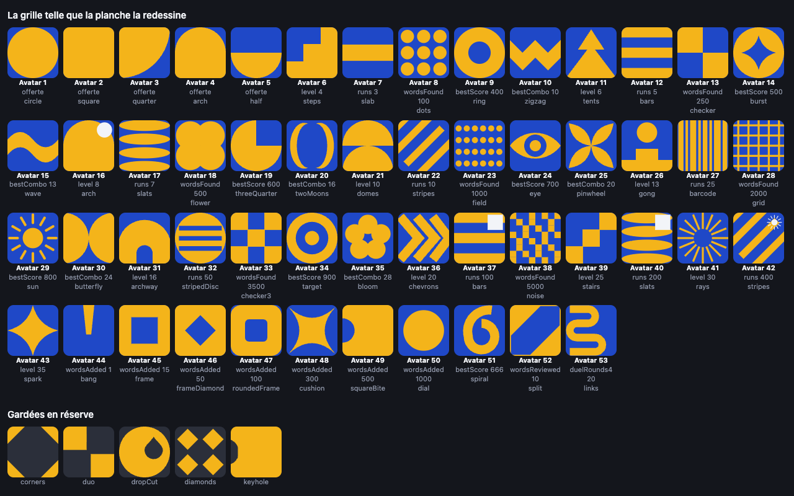

# Grille d'avatars, tirée de la planche bauhaus

Ta planche (66 cases, une quarantaine de figures distinctes) donne son
vocabulaire à la grille. La proposition est appliquée : `LOOKS` porte ces 53
cases, leurs figures, leurs accents et leurs mouvements. Aucun identifiant de
tuile n'a bougé — un joueur qui portait la case 38 garde la case 38, c'est son
dessin qui a changé.

## L'accent colore une part de la figure

C'est le fond de la grille : l'accent ne pose plus un petit motif dans un coin,
il **colorie une part de la figure elle-même** — le rond du gong, la ligne du
bas du champ de points, la première flèche des chevrons, le carré du milieu de
l'escalier. La part est dessinée à part (`DetailKind`) et rendue par-dessus dans
la couleur d'accent du joueur : si le joueur choisit la même couleur pour sa
forme et son accent, la part s'efface, exactement comme pour le point du « ! ».

**42 tuiles sur 53** ont ainsi une part colorable. Les dix autres sont d'un
seul tenant : les cinq offertes, `slab`, `wave`, `threeQuarter`, `spark` et
`cushion` — l'accent n'y a rien à colorer.

- **le point du « ! »** (Avatar 44) : `bang` garde son trait et son point
  (`bangDot`).
- **l'ancien Niveau 16** (Avatar 31) : `half` et son rond en coin, tel quel.
  C'est la seule tuile qui garde un motif en coin.
- **les Avatars 37, 40 et 42** (100, 200 et 400 parties) : leur accent de coin
  s'en va, chacune a une figure que rien d'autre ne porte — `halfBars` (un
  registre), `bands` (quatre chevrons empilés), `peaks` (un semis de pointes).
- Les 42 parts sont branchées dans `TINTED` : le tableau ci-dessous dit, tuile
  par tuile, ce que l'accent colore.

## Les mouvements

Chaque figure a le sien, choisi pour elle : la marche monte par paliers, la
porte bat sur ses gonds, le gong sonne une fois puis se tait, l'aiguille du
cadran avance d'un cran toutes les deux secondes, l'œil cligne, le carré mordu
se retourne, le bruit frissonne. Quarante et un mouvements pour cinquante-trois
tuiles : douze reviennent une seconde fois, jamais sur deux figures de la même
famille.

- **Ce qu'ils touchent** : la transformation, et l'opacité pour le seul
  scintillement. Un seul élément par tuile, donc tout reste au compositeur —
  la grille en montre cinquante d'un coup, et rien ne repasse par le layout.
- **Ce qu'ils évitent** : le tour complet de la figure (`turn`, `spin`, `roll`)
  est réservé aux formes qu'un quart de tour ne change pas — un carré, un cadre,
  un moulin, un soleil —, sinon la case se lirait comme une autre. Une figure
  teintée reste d'aplomb (`turn: 0`) : sa part est dessinée droite, la tourner
  la désalignerait.
- **Ce qu'ils respectent** : le délai négatif de chaque tuile (`--i`) les
  désynchronise, les durées longues portent les figures calmes et les courtes
  les nerveuses, et `prefers-reduced-motion` les arrête tous.

## Ce que la planche a changé dans le code

- Une vingtaine de figures étaient déjà au catalogue : cercle, carré, anneau,
  cible, fleur (les quatre disques), points, damier, sablier, losange, croix,
  lentille, rayons (notre soleil), marches, chevrons, éventail.
- **37 figures ont été dessinées** (`src/ui/paths.tsx`, les mêmes noms que dans
  le tableau ci-dessous) : les 33 de la planche — `stairs` `tents` `gong`
  `chevrons` `slats` `barcode` `stripes` `stripedDisc` `field` `grid` `checker3`
  `diamonds` `noise` `burst` `threeQuarter` `spark` `eye` `links` `pinwheel`
  `butterfly` `twoMoons` `frameDiamond` `roundedFrame` `cushion` `squareBite`
  `split` `spiral` `rays` `corners` `duo` `slab` `dropCut` `keyhole` — plus
  `gate`, `halfBars`, `bands` et `peaks`.
- **42 parts** ont été dessinées à côté de leur figure (`DetailKind` dans
  `src/domain/avatar.ts`) et branchées dans `TINTED`.
- **41 mouvements** dans `src/domain/avatar.ts` (`Motion`), leurs images clés et
  leurs classes dans `src/styles.css` (section *poster*).

## La règle de la grille

Chaque piste a sa famille de figures, et la famille monte avec le seuil :
c'est ce qui fait qu'une tuile dit encore ce qu'elle a coûté.

| Piste | Famille | Ce que ça raconte |
|---|---|---|
| Niveau | ce qui s'empile : marches, tentes, porte, dôme, gong, chevrons, escalier, rayons, étoile | la montée |
| Parties | ce qui s'aligne : barre, barres, lattes, rayures, code-barres, disque rayé, registre, bandes, pointes | le tally |
| Mots trouvés | ce qui se compte : points, damier, fleur, champ, grille, damier 3×3, bruit | l'abondance |
| Score | ce qui se marque : anneau, disque étoilé, disque entamé, œil, soleil, cible | le coup |
| Série | ce qui s'enchaîne : zigzag, vague, deux lunes, moulin, papillon, fleur | la chaîne |
| Mots ajoutés | ce qui enferme : trait, cadre, cadre losangé, cadre arrondi, coussin, carré mordu, disque plein | le dictionnaire se remplit |
| Exploits | trois figures à part : spirale (« Trois six »), partage (« Juste arbitre »), méandre (« Marathon ») | l'exploit |

## Le tableau, tuile par tuile

« Avatar *n* » est la case `n - 1` du code, comme dans le récapitulatif des
succès. La part est ce que l'accent colore, le mouvement ce que fait la figure.

| Avatar | Ce qu'elle ouvre | Figure | Part en accent | Mouvement |
|---:|---|---|---|---|
| 1 à 5 | offertes | `circle` `square` `quarter` `arch` `half` (inchangées) | — | souffle, quarts de tour, immobile, flotte, balance |
| 6 | Niveau 4 | `steps` | la marche du milieu | `march`, monte par paliers |
| 7 | 3 parties | `slab` | — | `slide`, glisse de côté |
| 8 | 100 mots trouvés | `dots` | la ligne du bas | `count`, compte trois coups |
| 9 | Score 400 | `ring` | la moitié gauche | `roll`, roule en tanguant |
| 10 | Série 10 | `zigzag` | le premier pli | `wiggle`, frétille |
| 11 | Niveau 6 | `tents` | la petite tente | `tilt`, penche sur sa base |
| 12 | 5 parties | `bars` | la barre du milieu | `breathe`, se tasse |
| 13 | 250 mots trouvés | `checker` | un des deux carrés | `nod`, hoche |
| 14 | Score 500 | `burst` | l'étoile du milieu | `scatter`, éclate |
| 15 | Série 13 | `wave` | — | `ripple`, ondule |
| 16 | Niveau 8 | `gate` | le cintre | `hinge`, bat sur ses gonds |
| 17 | 7 parties | `slats` | la latte du haut | `drift`, dérive |
| 18 | 500 mots trouvés | `flower` | un pétale | `open`, s'ouvre |
| 19 | Score 600 | `threeQuarter` | — | `coin`, se pose en oscillant |
| 20 | Série 16 | `twoMoons` | la lune de gauche | `wane`, s'amincit |
| 21 | Niveau 10 | `domes` | le dôme du bas | `hover`, se soulève |
| 22 | 10 parties | `stripes` | une bande | `wiggle`, frémit |
| 23 | 1 000 mots trouvés | `field` | la ligne du bas | `pulse`, respire |
| 24 | Score 700 | `eye` | l'iris | `blink`, cligne |
| 25 | Série 20 | `pinwheel` | une pale | `spin`, tourne |
| 26 | Niveau 13 | `gong` | le disque | `chime`, sonne et vibre |
| 27 | 25 parties | `barcode` | la barre la plus large | `scan`, balaye |
| 28 | 2 000 mots trouvés | `grid` | la ligne du milieu | `drift`, défile |
| 29 | Score 800 | `sun` | le disque | `spin`, tourne |
| 30 | Série 24 | `butterfly` | l'aile gauche | `flutter`, bat des ailes |
| 31 | Niveau 16 | `half` + son rond en coin (sa tuile d'avant) | le rond, en coin | `bob`, sautille |
| 32 | 50 parties | `stripedDisc` | la bande du milieu | `roll`, roule en tanguant |
| 33 | 3 500 mots trouvés | `checker3` | le carré du centre | `breathe`, se tasse |
| 34 | Score 900 | `target` | le centre | `lock`, se verrouille |
| 35 | Série 28 | `bloom` | un pétale | `swirl`, tourne et s'épanouit |
| 36 | Niveau 20 | `chevrons` | la flèche de gauche | `dart`, file d'un trait |
| 37 | 100 parties | `halfBars` | la bande du bas | `press`, presse |
| 38 | 5 000 mots trouvés | `noise` | le second semis, intercalé | `shiver`, frissonne |
| 39 | Niveau 25 | `stairs` | le carré du milieu | `climb`, grimpe par paliers |
| 40 | 200 parties | `bands` | la bande du haut | `seesaw`, bascule |
| 41 | Niveau 30 | `rays` | les quatre rayons droits | `flare`, s'épanouit |
| 42 | 400 parties | `peaks` | la rangée du bas | `hop`, saute |
| 43 | Niveau 35 | `spark` | — | `twinkle`, scintille |
| 44 | 1 mot ajouté | `bang` | le point, sous le trait | `stamp`, tape |
| 45 | 15 mots ajoutés | `frame` | le panneau | `turn`, quarts de tour |
| 46 | 50 mots ajoutés | `frameDiamond` | le losange | `swing`, se balance |
| 47 | 100 mots ajoutés | `roundedFrame` | le carré arrondi | `press`, s'aplatit |
| 48 | 300 mots ajoutés | `cushion` | — | `squish`, s'écrase |
| 49 | 500 mots ajoutés | `squareBite` | la bouchée | `flip`, se retourne |
| 50 | 1 000 mots ajoutés | `dial` | l'aiguille | `tick`, avance d'un cran |
| 51 | Trois six (score 666) | `spiral` | le tour intérieur | `coil`, s'enroule |
| 52 | Juste arbitre (10 verdicts) | `split` | la bande | `slide`, glisse de côté |
| 53 | Marathon (20 manches de duel) | `links` | la boucle | `swing`, pendule |

## Les cinq gardées en réserve

Dessinées, dans le code, et ouvertes par aucun succès — de quoi habiller le
prochain barreau ou le prochain exploit sans rien redessiner :

`corners`, `duo`, `dropCut`, `diamonds`, `keyhole`.

## Ce que la grille abandonne

La grille ne montre plus vingt figures du catalogue : `six`, `card`, `ribbon`
(les trois tuiles d'exploit d'avant, remplacées par la spirale, le partage et
le méandre), `archway` (l'ancien Niveau 16, rendu à `half`), `star`, `heart`,
`moon`, `hourglass`, `lens`, `cross`, `corner`, `drop`, `pill`, `hexagon`,
`triangle`, `chevron`, `diamond`, `ringbroken`, `comma`, `eclipse`. Elles
restent dessinées, mais plus aucune tuile ne les porte : dis-moi si tu en veux
une, c'est le seul endroit où je peux me tromper.

Aucun identifiant de tuile ne bouge : 53 cases, 5 offertes, 45 barreaux,
3 exploits, les mêmes seuils, les mêmes succès. Les icônes Play Games, elles,
ne changent pas du tout : la Console n'en met jamais une à jour.
